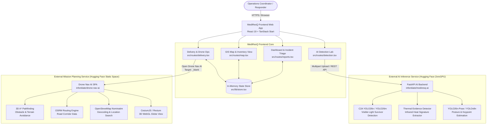

# MediResQ

**Intelligent Emergency Medical Response & Aerial Mission Coordination Platform**

MediResQ is an integrated emergency response management system designed to streamline disaster triage, medical supply allocation, and aerial delivery mission planning. The platform connects front-line incident reporting with remote computer-vision inference (RGB survivor detection, infrared thermal signature extraction, and posture analysis) and autonomous drone navigation capabilities in a unified, operational command interface.

[]()
[]()
[]()
[](https://infonitiate-mediresq-ai.hf.space)
[](https://infonitiate-drone-nav-ai.static.hf.space)

---

### Live Deployments

| Component | Host / Environment | Live URL |
| :--- | :--- | :--- |
| **MediResQ AI Backend** | Hugging Face Spaces (ZeroGPU) | [https://infonitiate-mediresq-ai.hf.space](https://infonitiate-mediresq-ai.hf.space/) |
| **Drone Nav AI Application** | Hugging Face Spaces (Static) | [https://infonitiate-drone-nav-ai.static.hf.space](https://infonitiate-drone-nav-ai.static.hf.space/) |
| **Frontend Source** | GitHub Repository | `https://github.com/SnehaKothawade07/pixel-perfect-replica.git` |

> [!NOTE]
> **Assistive Technology Notice:** MediResQ and its associated AI inference endpoints are engineering tools designed to assist emergency coordination teams. AI detections are advisory and must not replace professional clinical triage, formal medical judgment, or certified aviation command procedures.

---

## Overview

### The Problem
During natural disasters and mass-casualty events, emergency operations centers (EOCs) face significant operational friction:
- **Fragmented Triage:** Field reports, hotline calls, and aerial sensor feeds arrive across disparate, disconnected tools.
- **Delayed Survivor Localization:** Analyzing standard aerial video and thermal drone feeds manually consumes precious minutes during the critical "golden hour."
- **Supply Allocation Bottlenecks:** Coordinators struggle to match verified casualties with live inventory stocks across distributed hospitals and blood banks.
- **Mission Planning Disconnect:** Transferring confirmed delivery orders to drone navigation systems often requires manual coordinate re-entry, risking errors.

### The Solution
MediResQ provides an end-to-end operational pipeline:
1. **Intake & Verification:** Consolidates incident reports from field responders, community channels, and camera feeds into a structured triage queue.
2. **AI-Assisted Vision:** Uploads aerial drone imagery directly to a GPU-accelerated microservice for rapid human survivor detection, thermal hotspot extraction, and posture assessment.
3. **Inventory Matching:** Cross-references patient needs with current blood unit and trauma kit stocks across registered facilities.
4. **Flight Route Simulation & Dispatch:** Calculates distance and flight duration estimates, visualizes geographic routes, and hands mission parameters off to an integrated 3D drone navigation planner.

---

## Key Features

- **Triage & Incident Management:**
  - Multi-tier priority tagging (`Critical`, `High`, `Medium`, `Low`).
  - Structured review lifecycle (`Awaiting Review` → `Under Review` → `Verified` / `Dismissed`).
  - Role-based permissions (`Reviewer`, `Responder`, `Admin`) for strict review accountability.
- **AI-Assisted Aerial & Thermal Detection:**
  - Multi-modal inference: Visible RGB imagery, thermal infrared, and human posture estimation.
  - Interactive bounding-box canvas visualizer with adjustable confidence filters.
  - Direct workflow bridge: Convert any confirmed AI detection into an active emergency incident with one click.
  - Server health and model latency monitor with runtime endpoint switching.
- **Medical Inventory Tracking:**
  - Real-time stock counts across hospitals and blood banks.
  - Categorized management for blood products, trauma consumables, and pharmaceuticals.
  - Expiry monitoring and storage condition indicators (cold chain, ambient).
- **Delivery Mission Planning:**
  - Automated Haversine distance and transit time calculations between origin facilities and incident coordinates.
  - 4-stage mission execution simulation (`Pending` → `Planned` → `In Transit` → `Delivered`).
  - Flight route vector rendering overlaid on geographic maps.
- **Drone Nav AI Integration:**
  - Direct integration with Drone Nav AI hosted on Hugging Face Static Spaces.
  - One-click launch in a secure secondary viewport (`target="_blank"` with `rel="noopener noreferrer"`).
  - Mission ID and destination coordinates context transfer.
- **Operational GIS Map:**
  - Interactive Leaflet-powered GIS dashboard featuring facility markers, emergency incidents, and active delivery paths.
  - SSR-safe lazy loading architecture preventing browser/Node hydration mismatches.
- **Audit Activity Log:**
  - Comprehensive operational ledger recording every triage decision, inventory dispatch, and report update with ISO timestamps.

---

## System Architecture



---

## AI Detection System

The MediResQ AI Detection Backend is hosted as a dedicated microservice on **Hugging Face ZeroGPU** (`infonitiate/mediresq-ai`). It provides high-throughput, low-latency computer vision inference on aerial imagery without bundling heavy model weights or PyTorch runtimes into the client application.

### Production Endpoints

| Endpoint | Method | Input Format | Primary Model / Technique | Purpose |
| :--- | :--- | :--- | :--- | :--- |
| `/health` | `GET` | None | System Diagnostics | Reports API availability, active model inventory, and GPU state. |
| `/detect/rgb` | `POST` | `multipart/form-data` (`file`) | C2A YOLO26n *(Fallback: YOLO26m)* | Detects human survivors in visible-light aerial/drone footage. |
| `/detect/thermal` | `POST` | `multipart/form-data` (`file`) | Adaptive Intensity & Contour Thresholding | Isolates thermal infrared heat signatures in disaster zones. |
| `/detect/person` | `POST` | `multipart/form-data` (`file`) | YOLO26n-Pose *(Fallback: YOLOv8n)* | Identifies individuals and classifies posture (`lying` vs. `standing/upright`). |

### Standardized Response Contract

```json
{
  "success": true,
  "model": "C2A YOLO26n (Survivor RGB)",
  "image_width": 1920,
  "image_height": 1080,
  "inference_time_ms": 38.4,
  "detections": [
    {
      "label": "person",
      "confidence": 0.892,
      "x1": 412.5,
      "y1": 218.0,
      "x2": 520.0,
      "y2": 445.2,
      "bbox": [412.5, 218.0, 520.0, 445.2]
    }
  ]
}
```

- **Frontend Client:** Managed via [`src/lib/detection-api.ts`](file:///d:/MECH/pixel-perfect-replica-main/src/lib/detection-api.ts), which normalizes varied bounding-box coordinate styles (`xyxy`, `xywh`, normalized `0.0–1.0` or pixel coordinates) into a reliable presentation format.
- **Dynamic Override:** Operators can test alternate backend instances via runtime configuration saved in local browser storage.

---

## Drone Nav AI Integration

MediResQ integrates with **Drone Nav AI**, a specialized mission-planning application deployed as a Hugging Face Static Space:
- **Production URL:** [https://infonitiate-drone-nav-ai.static.hf.space](https://infonitiate-drone-nav-ai.static.hf.space/)
- **Space Repository:** [https://huggingface.co/spaces/infonitiate/drone-nav-ai](https://huggingface.co/spaces/infonitiate/drone-nav-ai)

### Integration Architecture
- **Decoupled Architecture:** MediResQ handles incident triage, priority review, and supply dispatch. When a delivery mission is established, operators trigger the **"Open Drone Nav AI"** launcher.
- **Secure Cross-Origin Navigation:** Opened via a hardened anchor link with `target="_blank"` and `rel="noopener noreferrer"`, preserving tab isolation and eliminating popup blocker interference.
- **Environment Driven:** Configured via `VITE_DRONE_NAV_AI_URL` and resolved safely through [`src/lib/drone-nav.ts`](file:///d:/MECH/pixel-perfect-replica-main/src/lib/drone-nav.ts), which enforces strict URL protocol validation (`http:` / `https:`) and automatically normalizes trailing slashes.
- **Drone Nav AI Capabilities:**
  - **3D A\* Pathfinding:** Computes obstacle-free flight trajectories across simulated 3D elevation and building profiles.
  - **OSRM Integration:** Queries Open Source Routing Machine APIs for emergency corridor alignment.
  - **Nominatim Geocoding:** Converts incident street addresses and landmarks into precise GPS coordinates.
  - **CesiumJS & Resium:** Interactive WebGL 3D globe visualization of drone flight paths and waypoint sequences.

---

## Technology Stack

| Domain | Technology / Library | Version | Purpose |
| :--- | :--- | :--- | :--- |
| **Frontend Framework** | React | `^19.2.0` | Declarative UI rendering |
| **Application Framework** | TanStack Start / React Router | `1.168.x / 1.170.x` | File-based routing, SSR hydration, layout engine |
| **Language** | TypeScript | `^5.8.3` | End-to-end static typing and domain contracts |
| **Build Tool & Server** | Vite / Nitro | `8.1.5 / 3.0-beta` | HMR dev server and production SSR bundler |
| **Styling** | Tailwind CSS / tw-animate-css | `^4.2.1 / ^1.3.4` | Utility-first responsive design and micro-animations |
| **UI Components** | Radix UI Primitives | Latest | Accessible dialogs, dropdowns, and form primitives |
| **Icons** | Lucide React | `^0.575.0` | Comprehensive operational UI iconography |
| **GIS & Mapping** | Leaflet / React-Leaflet | `1.9.4 / 5.0.0` | Interactive map layers and geographic coordinates |
| **State Management** | React Context (`src/lib/store.tsx`) | Native | Synchronized incident, supply, and delivery state |
| **Data Fetching** | TanStack React Query | `^5.101.1` | Asynchronous query management and caching |
| **Notifications** | Sonner | `^2.0.7` | Contextual operational alerts and dispatch toasts |
| **Unit Testing** | Vitest | `^4.1.10` | Fast unit testing with JSDOM environment |
| **Testing Utilities** | Testing Library (React / DOM) | `^16.0.0 / ^6.6.0` | Component render validation and assertions |
| **Code Quality** | ESLint / Prettier | `^9.32.0 / ^3.7.3` | Linting and code format consistency |
| **AI Inference Backend** | Python / FastAPI / Ultralytics YOLO | 3.10+ | Remote object detection and pose estimation |
| **AI Cloud Infrastructure** | Hugging Face Spaces (ZeroGPU) | Cloud | Dynamic GPU allocation for neural network inference |

---

## Project Structure

```text
pixel-perfect-replica-main/
├── .env.example              # Sample environment configuration template
├── .env                      # Local environment overrides (gitignored)
├── .gitignore                # Git exclusion rules
├── .vercelignore             # Vercel deployment exclusions (backend/models)
├── AGENTS.md                 # Project development guidelines and constraints
├── package.json              # Project scripts and dependency manifest
├── tsconfig.json             # TypeScript compiler configuration
├── vercel.json               # Vercel production hosting configuration
├── vite.config.ts            # Vite build configuration with TanStack Start
├── vitest.config.ts          # Vitest unit testing configuration
│
├── public/                   # Static assets served at root
│   ├── favicon.ico
│   └── robots.txt
│
├── src/
│   ├── assets/               # Bundled sample drone images (RGB, thermal)
│   ├── components/           # Reusable UI components
│   │   ├── AppShell.tsx      # Sidebar navigation, header, and role selector
│   │   ├── LazyMap.tsx       # SSR-safe dynamic import wrapper for Leaflet
│   │   ├── MapView.tsx       # Leaflet map rendering facilities and markers
│   │   ├── ui-bits.tsx       # Status badges, empty states, and metric cards
│   │   └── ui/               # Radix UI styled primitives (buttons, dialogs)
│   ├── lib/                  # Core utilities and data services
│   │   ├── api.ts            # Service abstraction layer
│   │   ├── demo-data.ts      # Initial operational facilities and incident data
│   │   ├── detection-api.ts  # Hugging Face ZeroGPU AI client and bbox parser
│   │   ├── drone-nav.ts      # Drone Nav AI URL loader and validator
│   │   ├── store.tsx         # Central React Context state store
│   │   └── types.ts          # Domain type definitions (Reports, Deliveries)
│   ├── routes/               # TanStack Start file-based route definitions
│   │   ├── __root.tsx        # Application shell layout and navigation frame
│   │   ├── index.tsx         # Operational overview dashboard
│   │   ├── reports.tsx       # Incident intake, triage, and review workflow
│   │   ├── inventory.tsx     # Medical supply inventory tracking
│   │   ├── delivery.tsx      # Mission dispatch, route calculation & Drone Nav AI link
│   │   ├── detection.tsx     # AI-assisted aerial & thermal detection workbench
│   │   ├── activity.tsx      # Immutable operational audit ledger
│   │   └── map.tsx           # Full-screen GIS operational map view
│   └── test/                 # Automated test suites
│       ├── app-routing.test.tsx    # Router initialization and view validation
│       ├── detection-api.test.ts  # Base URL resolution and bbox parsing tests
│       └── drone-nav.test.ts      # Drone Nav AI URL validation and env tests
│
└── backend/                  # Source files for the Hugging Face AI microservice
    ├── app.py                # FastAPI server with Gradio ZeroGPU decorators
    ├── requirements.txt      # PyTorch, Ultralytics, OpenCV dependencies
    └── models/               # Model weights (c2a_yolo26n, yolo26m, pose, yolov8n)
```

---

## Environment Variables

MediResQ uses Vite environment variables (`VITE_*`) to connect the frontend to distributed production microservices.

### Configuration (`.env.example`)

```dotenv
# MediResQ Environment Configuration Example
# Copy this file to .env and configure for your environment.

# External Drone Nav AI application URL (production Hugging Face Static Space or local)
VITE_DRONE_NAV_AI_URL=https://infonitiate-drone-nav-ai.static.hf.space

# External AI model server base URL (production Hugging Face ZeroGPU space or local)
VITE_DETECTION_API_URL=https://infonitiate-mediresq-ai.hf.space
```

### Security Guidelines
- **Never commit `.env` or `.env.local` files** to version control. They are strictly excluded in `.gitignore`.
- **No Private Keys in Frontend:** The frontend client never stores private API tokens or credentials. All communications use public REST endpoints protected by CORS.

---

## Local Development

### Prerequisites
- **Node.js**: v20.x or higher (Node v22+ recommended)
- **Package Manager**: `npm` (v10+) or `bun`

### Setup Steps

1. **Clone the repository:**
   ```bash
   git clone https://github.com/SnehaKothawade07/pixel-perfect-replica.git
   cd pixel-perfect-replica-main
   ```

2. **Install dependencies:**
   ```bash
   npm install
   ```

3. **Configure environment:**
   ```bash
   cp .env.example .env
   ```
   *(The default `.env.example` comes pre-configured with the live production Hugging Face endpoints for immediate testing.)*

4. **Start the local development server:**
   ```bash
   npm run dev
   ```
   Open your browser at `http://localhost:8080` (or the port indicated in your console output).

---

## Testing & Quality Verification

MediResQ maintains a strict test and build verification suite. All four checks must pass cleanly prior to production release.

```bash
# 1. Run unit test suite (Vitest)
npm test

# 2. Perform static TypeScript type-checking
npx tsc --noEmit

# 3. Lint integrated source code
npx eslint src/lib/drone-nav.ts src/test/drone-nav.test.ts src/routes/delivery.tsx

# 4. Generate production build bundle
npm run build
```

### Current Verification Status

| Check | Tool | Result | Details |
| :--- | :--- | :--- | :--- |
| **Unit Tests** | Vitest 4.1 | **PASSED** | 16 of 16 tests passing across URL validation, detection client, and routing. |
| **Type Check** | TypeScript 5.8 | **PASSED** | Exit code 0, 0 compiler errors. |
| **Linting** | ESLint 9 | **PASSED** | 0 errors across all modified integration modules. |
| **Production Build** | Vite + Nitro | **PASSED** | Client bundles and SSR server chunks generated successfully in `.output/`. |
| **Localhost Check** | `grep` / Search | **CLEAN** | 0 references to `localhost:3000` remaining in source code or production bundles. |

---

## Deployment Architecture

MediResQ is deployed using a decoupled, multi-tier architecture to maximize performance, scalability, and cost efficiency.

```text
┌────────────────────────────────────────────────────────────────────────┐
│                        MediResQ Production Fleet                       │
├──────────────────────────┬─────────────────────────┬───────────────────┤
│ Tier                     │ Platform                │ Responsibility    │
├──────────────────────────┼─────────────────────────┼───────────────────┤
│ Frontend Web App         │ Vercel                  │ UI, Routing, SSR  │
│ AI Computer Vision API   │ Hugging Face (ZeroGPU)  │ Model Inference   │
│ Drone Flight Planner     │ Hugging Face (Static)   │ 3D Navigation SPA │
└──────────────────────────┴─────────────────────────┴───────────────────┘
```

### Why Decouple the AI Backend?
- **Serverless Limitations:** Serverless frontend hosting platforms (such as Vercel) enforce strict function bundle size ceilings (e.g., 500 MB). The PyTorch runtime, CUDA dependencies, and YOLO neural network weights total ~6 GB—far exceeding serverless limits.
- **On-Demand GPU Acceleration:** Hugging Face ZeroGPU dynamically allocates NVIDIA GPUs on demand for compute-intensive image inference, scaling down to zero when idle to conserve resources.
- **Independent Lifecycles:** The frontend web interface and AI models can be updated, benchmarked, and deployed independently without rebuilding or redeploying the other.

---

## Production Services

| Service | Platform | Scope & Responsibility | Status |
| :--- | :--- | :--- | :--- |
| **MediResQ Web App** | Vercel | Operations dashboard, incident triage, and inventory coordination. | Ready for Production |
| **MediResQ AI Backend** | Hugging Face Space (`infonitiate/mediresq-ai`) | ZeroGPU-powered FastAPI backend serving YOLO RGB, thermal, and pose models. | **Active / Running** |
| **Drone Nav AI** | Hugging Face Space (`infonitiate/drone-nav-ai`) | Client-side 3D A\* flight path planning and simulation with CesiumJS. | **Active / Running** |

---

## Security & Privacy Considerations

- **URL Protocol Validation:** External links and mission URLs are sanitized using [`validateDroneNavUrl()`](file:///d:/MECH/pixel-perfect-replica-main/src/lib/drone-nav.ts#L17-L34), rejecting invalid protocols or malicious URI schemes (`javascript:`, `data:`).
- **Tab Isolation:** External application links enforce `rel="noopener noreferrer"` to prevent window opener hijacking and protect browser process isolation.
- **Zero Client-Side Credentials:** The frontend application does not embed secret API keys, service accounts, or administrative credentials.
- **Data Privacy in Emergencies:** In live operational scenarios, emergency patient records, triage photos, and location coordinates must be transmitted over encrypted HTTPS channels and adhere to local patient privacy regulations.

---

## System Limitations

- **Advisory AI Predictions:** Computer vision detection outputs can be affected by weather conditions (heavy rain, fog), extreme camera angles, severe occlusion, and poor lighting. Human confirmation is mandatory before dispatching critical resources.
- **Hardware Telemetry Simulation:** The current MediResQ delivery module simulates payload progression and route metrics. Direct hardware flight controllers (e.g., PX4 / ArduPilot via MAVLink) require dedicated companion telemetry integrations.
- **Not a Certified Medical Device:** MediResQ is an engineering coordination framework and has not undergone formal FDA, CE, or clinical software certification.

---

## Planned Roadmap

- [ ] **Live MAVLink Telemetry:** Direct telemetry uplink with ArduPilot/PX4 flight controllers for live battery, altitude, and GPS tracking.
- [ ] **Multi-Drone Fleet Deconfliction:** Real-time spatial separation algorithms to coordinate multiple simultaneous delivery flights.
- [ ] **Weather & Airspace Layers:** Live Doppler radar, wind vector maps, and active NOTAM (Notice to Airmen) airspace restriction overlays.
- [ ] **Offline PWA Support:** Service worker caching and IndexedDB queueing for continuous field use during terrestrial network blackouts.
- [ ] **FastAPI Persistence Layer:** Production migration of in-memory store state to a PostgreSQL / PostGIS backend with Row-Level Security.

---

## Contributing

Contributions from the engineering, disaster-response, and open-source communities are welcome.

1. **Fork the Repository** on GitHub.
2. **Create a Feature Branch:**
   ```bash
   git checkout -b feature/improved-triage-filters
   ```
3. **Commit your Changes:**
   ```bash
   git commit -m "feat: add multi-criteria triage filter to reports view"
   ```
4. **Verify Quality Checks:**
   ```bash
   npm test
   npx tsc --noEmit
   npm run build
   ```
5. **Push to your Fork and Submit a Pull Request** describing your changes and test coverage.

---

## License

License: Not currently specified.

---

## Acknowledgements

- **[Hugging Face](https://huggingface.co/):** For Spaces hosting and ZeroGPU computing resources.
- **[Ultralytics](https://github.com/ultralytics/ultralytics):** For the YOLO computer vision and pose estimation architectures.
- **[OpenStreetMap](https://www.openstreetmap.org/) & [Nominatim](https://nominatim.org/):** For map tiles and open geocoding services.
- **[OSRM Project](http://project-osrm.org/):** For high-performance routing network calculations.
- **[Leaflet](https://leafletjs.com/):** For client-side mobile-friendly interactive mapping.
- **[TanStack](https://tanstack.com/):** For TanStack Start and TanStack Router.

---

## Disclaimer

> [!CAUTION]
> **IMPORTANT DISCLAIMER:** MediResQ is an experimental engineering and educational project developed for emergency response simulation and research. It is **NOT** a certified medical device, emergency dispatch authority, or aviation navigation authority. All AI detection outputs, survivor estimates, and route calculations are strictly advisory and must be verified by certified medical personnel, licensed drone pilots, and official emergency coordinators before any physical action is taken.
